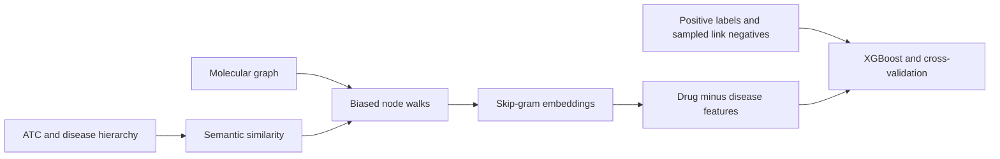

# DREAMwalk reproduction and controlled experiments

Code for the BMI5101 Group 8 reproduction of the [DREAMwalk paper by Bang et al. (2023)](https://doi.org/10.1038/s41467-023-39301-y).

This repository contains DREAMwalk experiments on **MSI, Hetionet and KEGG**, MSI baseline reconstructions, and controlled analyses of walk generation and Skip-gram training. It preserves the original implementation alongside explicitly labeled diagnostic variants.

**Main finding:** Hetionet reaches comparable performance, KEGG scores higher on a different reconstructed snapshot, and MSI remains below the paper. MSI node2vec, edge2vec and SEAL comparisons support the shared molecular inputs and evaluation. A combined DREAMwalk variant reaches MSI AUROC **0.916308**, compared with **0.882394** for the original algorithm on the revised MeSH2024 input and **0.944060** in the paper. These observations support partial reproduction; they do not establish the cause of every remaining difference.

## 1. Repository contents

```text
00.Reproduction/
├── 00.DREAMwalk_reproduction/
│   ├── notebooks/       # MSI controls, Hetionet and KEGG entry points
│   ├── src/             # Preparation, audits, runners and diagnostic variants
│   ├── tests/           # Synthetic protocol, patch and routing checks
│   ├── environment/     # Python 3.8 environment specification
│   ├── colab/           # Separate Linux notebook and bundle-building code
│   ├── references/      # Extracted Hetionet/KEGG paper references
│   └── vendor/          # Unmodified pinned DREAMwalk source
├── 01.node2vec_reproduction/
├── 02.DTi2vec_reproduction/
├── 03.edge2vec_reproduction/
└── 04.SEAL_reproduction/
reference_results/       # Historical summary metrics; not active checkpoints
README.md
```

Each model directory contains its notebook, source and environment specification. Baseline directories also contain extracted paper-reference tables. Third-party source and license files are retained where applicable.

This is a **code release**. Local raw datasets, licensed UMLS files, processed research inputs, walk corpora, trained models, installed environments, logs and historical checkpoint configurations are not included. Notebook outputs/execution counts are cleared. Working journals and duplicate notebook archives are omitted. No `.gitignore` files are tracked.

`reference_results/historical_metrics.csv` preserves 23 completed local result summaries, with their original relative paths and source-file SHA-256 values. These are historical observations, not runs executed during publication. They live outside active `results/` paths so that they cannot be mistaken for resumable checkpoints.

## 2. Notebook entry points

| Task | Notebook |
|---|---|
| MSI DREAMwalk baseline and controls | [MSI_DREAMwalk_local.ipynb](00.Reproduction/00.DREAMwalk_reproduction/notebooks/MSI_DREAMwalk_local.ipynb) |
| Original DREAMwalk on Hetionet | [Hetionet_DREAMwalk_local.ipynb](00.Reproduction/00.DREAMwalk_reproduction/notebooks/Hetionet_DREAMwalk_local.ipynb) |
| Original DREAMwalk on KEGG | [KEGG_DREAMwalk_local.ipynb](00.Reproduction/00.DREAMwalk_reproduction/notebooks/KEGG_DREAMwalk_local.ipynb) |
| MSI node2vec | [MSI_node2vec_seed0_local.ipynb](00.Reproduction/01.node2vec_reproduction/notebooks/MSI_node2vec_seed0_local.ipynb) |
| MSI DTi2vec reconstruction | [MSI_DTi2vec_seed0_local.ipynb](00.Reproduction/02.DTi2vec_reproduction/notebooks/MSI_DTi2vec_seed0_local.ipynb) |
| MSI edge2vec | [MSI_edge2vec_seed0_local.ipynb](00.Reproduction/03.edge2vec_reproduction/notebooks/MSI_edge2vec_seed0_local.ipynb) |
| MSI SEAL | [MSI_SEAL_seed0_local.ipynb](00.Reproduction/04.SEAL_reproduction/notebooks/MSI_SEAL_seed0_local.ipynb) |
| Historical MSI Linux comparison | [DREAMwalk_MSI_seed0_Colab.ipynb](00.Reproduction/00.DREAMwalk_reproduction/colab/DREAMwalk_MSI_seed0_Colab.ipynb) |

The notebooks expose parameters, individual computation stages and result displays. They use a local Python 3 host kernel to launch model-specific interpreters. Baseline notebooks can create their own environments on first use. A prepared workspace is required for MSI: cloning this code alone does not supply the saved inputs and historical artifacts used by its controls.

**Choose sections deliberately in the MSI notebook.** Its controls follow the historical investigation and some require completed reference experiments. Do not treat `Run All` as a short fresh-clone demonstration.

## 3. Setup and inputs

### 3.1 Clone and restore the upstream version check

```bash
git clone https://github.com/Fraxinus-mandshurica/BMI5101_Group8_collaborate.git
cd BMI5101_Group8_collaborate
```

The DREAMwalk snapshot is included as ordinary source files. Its original `.git` directory is not published. Several runners intentionally check upstream `HEAD` and tracked-source cleanliness. Restore that metadata once before using those runners:

```bash
UPSTREAM_DIR=00.Reproduction/00.DREAMwalk_reproduction/vendor/DREAMwalk_upstream
git -C "$UPSTREAM_DIR" init
git -C "$UPSTREAM_DIR" remote add origin https://github.com/eugenebang/DREAMwalk.git
git -C "$UPSTREAM_DIR" fetch --depth 1 origin 2f93723c3fbfa899d0f23c02e3459de8bfac0581
git -C "$UPSTREAM_DIR" reset --mixed FETCH_HEAD
git -C "$UPSTREAM_DIR" diff --exit-code HEAD --
```

These commands populate upstream metadata and index without changing the included source files. Run them once in a fresh clone; an existing upstream checkout with the correct commit does not need reinitialization. The final command should produce no diff.

### 3.2 DREAMwalk environment

Install conda/mamba and a working C++ compiler. From the repository root:

```bash
conda env create \
  --prefix ./00.Reproduction/00.DREAMwalk_reproduction/environment/.conda-env \
  --file ./00.Reproduction/00.DREAMwalk_reproduction/environment/environment-macos-arm64.yml
```

Python **3.8** pins: NumPy 1.23.3, SciPy 1.9.1, scikit-learn 1.1.3, NetworkX 2.8.8, pandas 1.4.4, tqdm 4.64.1, parmap 1.6.0 and XGBoost 1.7.4. The local wrapper scripts include the original macOS SDK/compiler adaptation; paths to a specific SDK may need adjustment on another machine. The separate Colab notebook prepares the authors' Python 3.8 environment on Linux.

Node2vec, DTi2vec and edge2vec use their own Python 3.8 environments with Gensim 4.3.2. SEAL uses Python 3.11, PyTorch 2.4.0 CPU, NumPy 1.26.2, SciPy 1.11.4 and scikit-learn 1.3.2. See each `environment/` directory and notebook bootstrap.

### 3.3 MSI molecular and semantic inputs

The public molecular source is [MSI v1.0.0](https://github.com/snap-stanford/multiscale-interactome/tree/ed8316f81626ceef23ebb3c55404b1eeca707aa9), with the selected TSVs from the [official data archive](https://snap.stanford.edu/multiscale-interactome/data/data.tar.gz). Place these under `00.Reproduction/00.DREAMwalk_reproduction/data/msi_raw/`:

```text
1_drug_to_protein.tsv
2_indication_to_protein.tsv
3_protein_to_protein.tsv
4_protein_to_biological_function.tsv
5_biological_function_to_biological_function.tsv
6_drug_indication_df.tsv
7_drug_classification_df.tsv
```

`src/prepare_msi.py` creates the molecular graph, node types, separate positive labels and initial ATC hierarchy. `audit_msi.py` and `audit_msi_atc.py` inspect the sources and produce mapping/edge audits. The retained graph has **29,959 nodes and 478,728 non-treatment input rows**, with **5,926 positive drug–disease labels** kept outside it.

The semantic route is separate:

- **Drugs:** public MSI drug-to-ATC assignments and ATC ancestry; 1,328/1,661 graph drugs have coverage.
- **Diseases:** local licensed UMLS `SAB=MSH` Descriptor candidates, connected to MeSH Tree Number ancestry; 748/840 diseases have usable primary mappings.
- Supply licensed `data/umls/MRCONSO.RRF` yourself. It is never uploaded here.
- Supply MeSH2024 at `data/mesh/2024/d2024.bin`; optional historical MeSH2021 at `data/mesh/2021/d2021.bin`. These are **MeSH versions**, not the MSI graph's year.
- `map_msi_cui_to_mesh.py` preserves the exploratory public mapping audit. `map_msi_cui_to_mesh_umls.py` records the subsequent direct UMLS mapping and comparison. `build_msi_semantic_hierarchy.py` constructs path-preserving ancestry.
- Position-qualified internal nodes such as `DescriptorID@TreeNumber` preserve multiple genuine MeSH positions without inventing cross-branch paths. Current MeSH2024 controls additionally include namespaced letter categories such as `C_dis` between top-level tree positions and the disease root.

The mapping scripts preserve historical audit dependencies. MSI controls expect the reviewed processed files, saved seed-0 negatives and reference checkpoint records from that preparation workflow. Typical shared files are:

```text
data/processed/msi_graph.tsv
data/processed/msi_nodetypes.tsv
data/processed/msi_positive_pairs.tsv
data/processed/msi_semantic_hierarchy_final.csv
data/processed/msi_similarity_graph_final.txt
results/msi_repeat0_negative_pairs.csv
results/msi_repeat0_run_config.json
```

Later controls also require their reference corpus, token map, binary, fold IDs and completion records. Restore those original artifacts to reuse a historical run, or execute the prerequisite preparation/run stages with compatible source and distinct run names. The published summary tables cannot replace checkpoint records. Translation changes the shared display helper's bytes; source-fingerprint guards may therefore reject some old checkpoints. Do not rewrite old fingerprints to bypass those guards.

### 3.4 Hetionet and KEGG inputs

**Hetionet:** its notebook downloads hash-checked, fixed public sources: Hetionet nodes/edges, historical Disease Ontology, and DrugBank slim ATC assignments. Native DOIDs connect directly to disease ancestry; no UMLS-to-MeSH conversion is involved. After removing molecular isolates, **751 of 755 raw CtD positives** remain evaluable. Drug ATC coverage is 1,188/1,440; disease DO coverage is 134/134. The original reader loads 635,741 MultiGraph edges from 638,304 molecular input rows; unique endpoint pairs are a different count.

**KEGG:** its notebook downloads and freezes public REST/BRITE responses. Six molecular relation types follow Supplementary Table 4; drug–disease associations remain labels. Native KEGG drugs use ATC paths from BRITE `br08303`; diseases use ICD-11 ancestry from `br08403`. Using BRITE ATC assignments instead of the paper's DrugBank source is an explicit reconstruction difference.

The completed KEGG snapshot has **20,613 active nodes and 2,720 evaluable positive pairs**, compared with paper counts of 22,928 listed nodes and 2,272 positive associations. Nodes comprise 6,067 drugs, 2,605 diseases, 11,400 genes and 541 pathways. Higher scores on this snapshot are not exact replication of the historical benchmark. Follow the source providers' access and redistribution terms; datasets are not bundled here.

## 4. Model and evaluation protocol



Default DREAMwalk settings are fixed: **τ=0.3**, similarity cutoff **0.4**, **100 walks per node**, length **10**, `p=q=1`, at most **5 EM iterations**, **4 workers**, **128 dimensions**, window **4**, one Skip-gram epoch, five negative draw attempts and subsampling `0.001`. Original heterogeneous Skip-gram uses `pp=1`.

Length 10 follows the supplement/released code despite the main Methods mentioning length 4. τ=0.3 follows the demo and accepted local configuration; it is not presented as an explicitly specified Figure 2a optimum.

XGBoost uses 500 trees, depth 6, learning rate 0.1, gamma 0, min_child_weight 4, subsample 0.8, colsample_bytree 0.9, scale_pos_weight 1, max_delta_step 1, seed 0 and four jobs. Features are **drug embedding − disease embedding**. Treatment labels do not enter the DREAMwalk molecular embedding graph.

Two different mechanisms are called negative sampling:

1. **Link-level negatives:** unlabeled drug–disease pairs used as classifier labels. MSI uses the same locally generated and saved 5,926 seed-0 negatives across controls. The authors' exact negative-pair IDs are unavailable.
2. **Skip-gram negatives:** noise output nodes used to train embeddings from walk-window context pairs. The original C++ `pp=1` chooses a pool by **input-node type**; `pp=0` uses a global pool. These are not classifier-negative pairs.

Most local results are **one seed × ten stratified folds**, with fixed pair order and seed 0. Folds are saved or deterministically regenerated and checked. The paper reports **ten repeats of ten-fold evaluation**; between-fold SD is not between-repeat SD. Accuracy uses rounded probabilities, AUROC uses probabilities, and AUPR is `average_precision_score`.

No extra startup hash seed is set in ordinary runs. Upstream `set_seed(0)` is retained. Spawn-worker RNG states and multithreaded Skip-gram are not assumed to be bitwise deterministic.

## 5. Original DREAMwalk across three datasets

| Dataset / result | Accuracy | AUROC | AUPR |
|---|---:|---:|---:|
| MSI, original algorithm, MeSH2024 with letter roots | 0.802736 | 0.882394 | 0.889991 |
| MSI, paper Figure 2a | 0.877098 | 0.944060 | 0.946767 |
| Hetionet, original algorithm | 0.849506 | 0.926881 | 0.921867 |
| Hetionet, paper Figure 2c | 0.852055 | 0.918076 | 0.915982 |
| KEGG, original algorithm, current snapshot | 0.933456 | 0.978860 | 0.978776 |
| KEGG, paper Figure 2d | 0.888669 | 0.952773 | 0.954531 |

MSI's first historical macOS seed-0 ten-fold run achieved AUROC **0.884284**. The later shared-corpus runs are separate stochastic executions and should not be treated as identical embeddings. Hetionet agreement supports a functioning original pipeline. KEGG is in the same broad performance range or higher, with substantial input-version/cohort differences. Neither result proves that every MSI-specific input choice matches the authors' benchmark.

## 6. MSI baseline comparisons

| Baseline | Local Accuracy | Local AUROC | Local AUPR | Paper AUROC | Paper AUPR |
|---|---:|---:|---:|---:|---:|
| node2vec | 0.648245 | 0.703811 | 0.701662 | 0.692508 | 0.691617 |
| edge2vec | 0.643351 | 0.694380 | 0.688271 | 0.687792 | 0.674132 |
| SEAL | 0.725110 | 0.791964 | 0.794376 | 0.793698 | 0.793758 |
| DTi2vec reconstruction | 0.881962 | 0.961616 | 0.966416 | 0.905716 | 0.909831 |

**node2vec:** shared molecular graph and saved negatives; p=q=1 uniform neighbor walks, 100/node, length 10; standard Gensim Skip-gram, 128D/window 4/one epoch/four workers; subtraction features and L2 Logistic Regression (C=1, lbfgs, max_iter=1000). The streaming sampler preserves the p=q=1 transition distribution, not an identical random-number sequence. Gensim's dynamic-window/learning-rate details differ from DREAMwalk C++.

**edge2vec:** same typed graph, without semantic edges or teleportation. Learn a transition matrix over five EM iterations, with one length-10 node walk per node per iteration and Pearson-plus-sigmoid metric 4; then generate 100 walks/node and use Gensim/LR. Original source is preserved separately from Python 3/Gensim 4 compatibility code. The execution copy also prevents a Wilcoxon call from overwriting Pearson correlation and corrects the backtracking assignment variable. The adapter uses per-node sampling rather than the upstream CLI's capped edge-start route. These choices are recorded as adaptations, not recovered author benchmark code.

**SEAL:** one-hop enclosing subgraphs, DRNL structural labels, existing 128D node2vec vectors and four node-type indicators. The CPU port preserves DGCNN's row-normalized convolution, latent dimensions [32,32,32,1], SortPooling at the 60th percentile with minimum k=10, Conv1d channels 16/32, hidden size 128 and dropout 0.5. Adam uses lr=1e-4, batch size 50, at most 50 epochs and validation-loss patience 10. Use a stratified 10% validation split within each outer training fold. This adapter keeps all DDA labels outside the graph and does not inject negatives through the original embedding helper. SEAL consumes node2vec features, so it does not independently eliminate random-walk inputs.

**DTi2vec:** gene-set Jaccard plus MeSH/ATC semantic similarity, fused by arithmetic mean, followed by an undirected top-K union graph. Add only each training split's positive DDA bridges. Select K from {5,10,20,50} using three-fold inner AUPR within ten outer folds, totaling 130 embedding/classifier fits. Use concatenated embeddings, training-fit MinMax scaling and XGBoost. The author MSI-specific K, fusion and complete preprocessing are unavailable; this is a documented reconstruction. Its higher score does not establish exact baseline reproduction or an improvement over the published method.

Node2vec/edge2vec consistency and especially SEAL's close agreement reduce the likelihood of a broad shared molecular-graph/evaluation failure. They do not validate DREAMwalk's semantic mapping or exact unpublished benchmark cohort.

## 7. Controlled DREAMwalk experiments

### 7.1 Completed embedding and walk controls

All rows below use the same MSI link-level seed-0 negatives and ten-fold evaluator unless stated otherwise. A shared corpus means **identical saved `walks.txt` bytes**, not merely the same graph. Separate corpus generations remain separate stochastic runs.

| Experiment | AUROC | Interpretation |
|---|---:|---|
| Historical no teleport, length 10, pp=1 | 0.865565 | Molecular traversal and type-biased walks remain active at τ=0 |
| No teleport, length 4, pp=1 | 0.832682 | Shortening both EM paths and final walks worsened performance |
| Shared no-teleport corpus, pp=1 | 0.866120 | Fixed-corpus reference |
| Same corpus, pp=0 | 0.881752 | Global NS branch improved this local run |
| Saved edge2vec walks, C++ pp=1, XGBoost | 0.867320 | Replacing walk source changed AUROC little |
| Same edge2vec walks, saved Gensim embedding, XGBoost | 0.878697 | Replacing the whole embedding stage had a larger effect |
| Historical semantic corpus, original pp=1 | 0.887113 | τ=0.3, historical hierarchy |
| Same historical semantic corpus, original pp=0 | 0.892066 | Smaller pp contrast with teleport enabled |
| MeSH2024 letter-root semantic corpus, original pp=1 | 0.882394 | Revised-input reference |
| Same revised semantic corpus, original pp=0 | 0.892104 | pp=0 remains higher in this run |
| First-hit teleport, historical hierarchy, pp=0 | 0.910671 | Original-selector pp=0 reference: 0.892066 |
| First-hit teleport, revised MeSH2024 hierarchy, pp=0 | 0.911353 | Original-selector pp=0 reference: 0.892104 |
| Positive-output-type NS, τ=0, pp=1 | 0.881369 | Input-type pp=1 reference: 0.866120 |
| Same output-type NS, reject current positive, τ=0 | 0.882343 | Small additional effect; not an explanation of the full gap |
| Original DREAMwalk, historical MeSH2021 hierarchy | 0.884649 | Historical MeSH2024 pp=1 reference: 0.887113 |
| Combined MeSH2024 variant, τ=0.3, modified pp=1 | **0.916308** | Multiple changes; not an isolated attribution |

The paper's **without-teleport** reference is AUROC **0.904701**, AUPR **0.911893** (`Figure4b` Source Data means). Its **SG** reference is AUROC **0.938501**, AUPR **0.941674** (`SupplementaryFigure5` means). These are extracted workbook values, not estimates from plots.

### 7.2 Teleport policy

The released cumulative-threshold selector can continue after a destination is selected, allowing a later neighbor to replace it. The diagnostic selector returns on the **first cumulative-weight hit**, while retaining candidate order, shuffle and random-draw conventions. It is installed and audited inside multiprocessing workers, including under macOS spawn.

The isolated control holds **pp=0**, inputs, EM matrix, token map, binary, negatives, folds and XGBoost fixed. It generates a new corpus for the new policy. Improvement is measured against the local original-selector run; it does not prove which code generated the authors' results.

Implementation: `teleport_selector_diagnostic.py`, `run_teleport_selector_control.py`, and the revised-input entry `run_teleport_mesh2024_control.py`.

### 7.3 Type-aware Skip-gram sampling

Both the released metapath2vec++ and DREAMwalk C++ implementations choose pp=1 noise pools by **input-node type**. The diagnostic alternative selects by **positive-output type**, following the output-type-conditioned formulation. This is a methodological variant rather than proof that the published benchmark used another implementation.

Isolate this change at **τ=0** on the exact saved corpus. Change the four pool selectors and corresponding type check from `last_word` to `word`. Preserve the frequency^0.75 distribution, draw count and other training settings.

A separate follow-up adds `if (target == word) continue;` only in the negative branch. A collision skips the current attempt without resampling; five attempts need not produce five negative updates. It does not filter every known positive pair or every context in the window. It produced only a small additional AUROC change.

Implementation: `run_ns_output_type_control.py` and `run_ns_positive_filter_control.py`. Patched C++ source/diffs are generated separately; vendor code remains unchanged.

### 7.4 Combined variant and hierarchy review

The final `msi_seed0_mesh2024_final_fixed` run combines first-hit teleportation, output-type NS and current-positive rejection with the MeSH2024 hierarchy containing letter-category roots. It achieves **Accuracy 0.835220, AUROC 0.916308, AUPR 0.922352**. The AUROC gap from the paper remains approximately **0.02775**.

Hierarchy review checked exact source paths and multiple Descriptor positions. Adding the letter-category layer changed semantic ancestry and 192 retained disease-similarity edges; it did not change the molecular graph. Sections 7–8 now share the revised hierarchy with Section 12, while old experiments keep their historical inputs. τ=0 controls do not traverse semantic edges, so MeSH differences alone cannot explain their remaining gap.

The combined result is not the sum of isolated effects: inputs and sampled corpora also differ across some historical comparisons. Historical `run_msi_seed0_final_fixed.py` retains the earlier MeSH2021 route; `run_msi_seed0_mesh2024_final_fixed.py` is the final 2024 entry.

## 8. Other analyses and outcomes

| Analysis | Observation | Conclusion within this investigation |
|---|---|---|
| Initial smoke checks and source audit | Checked graph format, node types, source versions and small pipeline execution | Smoke tests establish execution, not full benchmark performance |
| Five-fold versus ten-fold evaluation | Same historical embedding: AUROC 0.879557 → 0.884284 | Use ten folds; fold count did not close the gap |
| Local macOS versus Colab/Linux | AUROC 0.884284 versus 0.885656; AUPR 0.893138 versus 0.893331 | Environment change was small in this comparison |
| Five link-negative sets | AUROC range 0.884284–0.886214 with fixed embedding | These sampled sets did not explain the large MSI gap |
| XGBoost depth diagnostic | No-teleport AUROC 0.865565 at depth 6 versus 0.860579 at depth 5 | Retain released depth 6; no broad tuning was pursued |
| Teleport hash-order probe | Target distributions changed strongly between hash seeds on ten inspected nodes | Motivated scrutiny of destination selection |
| Full hashseed=1 sensitivity attempt | Worker environment verified as `PYTHONHASHSEED=1`; stopped during walks due to resource pressure | No completed embedding/evaluation or performance conclusion |
| Public mapping versus licensed UMLS audit | Explored public CUI mappings, then used direct Descriptor candidates and audited missing/ambiguous mappings | Mapping provenance and coverage remain explicit |
| MeSH2021 versus 2024 | Historical original pp=1 AUROC 0.884649 versus 0.887113 | This year change did not restore the paper score |
| ATC/hierarchy count and path audits | Distinguished all-source taxonomy counts, graph-reachable terms, memberships and hierarchy edges | Different count definitions should not be treated as the same object |

The full hashseed=1 attempt used a **diagnostic execution wrapper**: after unchanged upstream `set_seed(0)`, restore the environment variable before spawn workers start. Python and NumPy seeds in the parent were not reset to 1. Worker Python/NumPy RNG states were not verified as fixed at 0. This execution change is not an original benchmark configuration.

The Colab workflow uses the same frozen local inputs and saved negatives, creates the authors' Python 3.8 environment, and persists a completed embedding to Drive before downstream evaluation. Fold membership is recorded as **deterministically regenerated**. The binary input bundle is excluded here; `colab/build_colab_seed0_bundle.py` can rebuild it from the prepared historical workspace, including pinned upstream Git metadata.

Random teleportation was discussed as a possible control but has **no completed local result reported here**. It should not be counted as a successful validation.

## 9. Interpreting the remaining discrepancy

The investigation has not identified a single complete explanation for MSI. Plausible limits include unavailable original benchmark snapshots/mappings, semantic coverage and version drift, unknown exact evaluation pair identities, a different averaging protocol, and stochastic training variation. The effects measured here do not establish that any one of these accounts for the residual gap.

Shared molecular inputs are supported by the baseline results. Hetionet agreement supports the original pipeline's overall operation. At the same time, MSI no-teleport performance also remains below the paper, so **semantic mapping cannot be the sole explanation**. Locally sampled negative sets and the macOS/Linux comparison showed small changes in the tests performed.

Incomplete biomedical graphs introduce another dataset limitation: an unobserved relationship may be biologically real. Link-level sampling can assign an unknown association a negative classifier label; Skip-gram can also sample a genuinely related context as noise. Type-aware Skip-gram does not identify missing biological relationships. Sparse entities may receive fewer corrective positive updates, but graph degree alone does not establish exposure or explain this project's gap. A reduced Skip-gram dot product also does not imply a fixed reduction in downstream XGBoost score. These are limitations, not evidence of a measured failure for any particular pair.

The remaining discrepancy is documented as **partial reproduction with unresolved factors**. The controlled policy/NS variants provide a model-improvement direction without an exhaustive parameter search or a claim that exact paper reproduction has been achieved.

## 10. Verification and upstream provenance

Publication changes translate notebook narratives and display/error strings, clear outputs and consolidate documentation. Model parameters and algorithmic code are retained. Test fixtures for positive-output filtering now generate their prerequisite source from the pinned original instead of requiring a completed MSI experiment. SEAL's optional upstream-forward comparison needs the small test dependency in `environment/requirements-test.txt`.

Example test commands, run from the corresponding model directory:

```bash
# DREAMwalk, using its Python 3.8 environment
environment/.conda-env/bin/python -m unittest discover -s tests -v

# SEAL, using its Python 3.11 environment
environment/.conda-env/bin/python -m pip install -r environment/requirements-test.txt
environment/.conda-env/bin/python -m unittest discover -s tests -v
```

Tests use synthetic inputs, source patches, mocked scientific stages and small neural-network fixtures. They do not rerun the published MSI/Hetionet/KEGG benchmarks. Legacy vendor command-line examples are retained for provenance and may use Python 2 or old libraries; the supported baseline entry points use the documented adapters.

| Component | Pinned upstream revision |
|---|---|
| [DREAMwalk](https://github.com/eugenebang/DREAMwalk) | `2f93723c3fbfa899d0f23c02e3459de8bfac0581` |
| [edge2vec](https://github.com/RoyZhengGao/edge2vec) | `b9250bd17112d203c2a5b496b75b4b6b259da9ed` |
| [SEAL](https://github.com/muhanzhang/SEAL) | `ca1f019a15fb0c21796042165b4e6bee73981dd3` |
| [pytorch_DGCNN](https://github.com/muhanzhang/pytorch_DGCNN) | `50f504131ca66382f3f078ae98e59aa3ae35b795` |

Third-party code retains its original license notices. DREAMwalk's full tracked snapshot is included unchanged; edge2vec's example data ZIP and `.gitignore` are omitted. Its original snapshot manifest still records those upstream entries. SEAL/DGCNN include the source subset recorded in `vendor/manifest.json`. No claim of authorship or relicensing of those components is made.

Paper comparisons use the authors' [Source Data workbook](https://pmc.ncbi.nlm.nih.gov/articles/instance/10272215/bin/41467_2023_39301_MOESM4_ESM.xlsx). Per-model reference tables and provenance record extracted cells and values. Historical local tables retain their own run identities; no full benchmark was executed to prepare this release.
